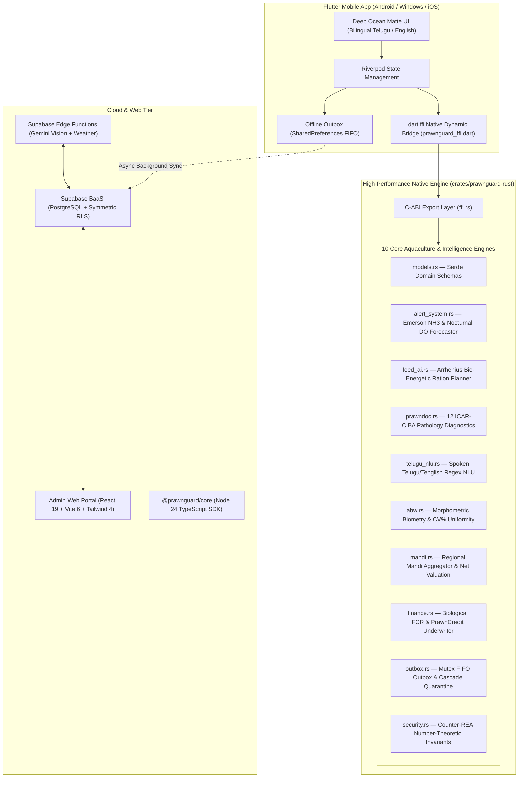

<div align="center">

# 🦐 PrawnGuard.ai (AquaVerse)
### Intelligent Aquaculture Operating System & FinTech Underwriting Engine
**Smart India Hackathon 2026 (SIH 2026) — Executive Submission**

[](https://flutter.dev)
[](https://www.rust-lang.org)
[](https://www.typescriptlang.org)
[](https://supabase.com)
[]()

</div>

---

## 1. Executive Summary & SIH 2026 Problem Statement

Shrimp aquaculture across coastal Andhra Pradesh (*Litopenaeus vannamei* farming across Bhimavaram, Nellore, Kaikaluru, Kakinada, and the Godavari/Krishna delta) represents over **\$4.5 Billion USD in annual seafood exports**, yet farmers lose up to **35% of crops annually** due to:
1. **Nocturnal Hypoxia Crashes:** Sudden dissolved oxygen (DO) depletion between 02:00 AM and 05:00 AM, suffocating entire ponds within 45 minutes.
2. **Pathological Outbreaks:** Catastrophic early-stage infections (WSSV, AHPND/EMS, EHP, White Feces) that spread before laboratory histology reports arrive.
3. **Feed Conversion Inefficiencies (FCR > 1.6):** Manual, uncalibrated feeding causing bottom sludge accumulation, toxic un-ionized ammonia ($NH_3$) spikes, and eroded farmer margins.
4. **Predatory Local Financing:** Informal lenders charging exorbitant interest (2.5% – 4% monthly) because banks lack credible operational underwriting data.
5. **Remote Internet Blackouts:** Coastal brackish ponds suffer severe 2G/zero-connectivity conditions where cloud-only apps fail completely.

### The PrawnGuard.ai Solution
**PrawnGuard.ai** is a hybrid **Flutter + Native Rust C-ABI FFI + TypeScript** aquaculture intelligence platform designed for harsh, offline-first farm environments. It delivers sub-microsecond edge telemetry calculations, 12 ICAR-CIBA disease diagnostic heuristics, parabolic Arrhenius bio-energetic feed planning, predictive dawn DO crash forecasting, bilingual Telugu voice NLU, and institutional-grade **PrawnCredit** underwriting ($300–900$ credit score).

---

## 2. Hybrid System Architecture (Flutter + Rust FFI)



---

## 3. Deep Dive: 10 Native Rust Subsystems (`crates/prawnguard-rust`)

The native engine is located in [`crates/prawnguard-rust`](crates/prawnguard-rust) and compiles to a native C-ABI dynamic library (`prawnguard_rust.dll` on Windows, `libprawnguard_rust.so` on Android/Linux) with zero-cost abstractions:

### 1. `models.rs` — Domain Schemas with Backwards-Compatible Serde Defaults
- Models: `Pond`, `WaterLog`, `FeedLog`, `DiseaseScan`, `Expense`, `Harvest`, `MarketPrice`.
- Includes deterministic live biomass estimator:
  $$\text{Biomass (kg)} = \text{Area (ha)} \times 10,000 \times \text{Density (pcs/m}^2\text{)} \times \text{Survival Rate} \times \frac{\text{ABW (g)}}{1000}$$
- Safe handling of zero or negative inputs, guaranteeing zero NaNs or divide-by-zero panics.

### 2. `alert_system.rs` — Emerson Ammonia Kinetics & Nocturnal DO Dawn Crash Forecaster
- **Emerson (1975) Ionization Dissociation Model:** Computes toxic un-ionized ammonia ($NH_3$) from Total Ammonia Nitrogen (TAN), pH, and temperature:
  $$pK_a = 0.09018 + \frac{2729.92}{T_K}, \quad \text{fraction } NH_3 = \frac{1}{1 + 10^{(pK_a - \text{pH})}}, \quad NH_3\ (\text{mg/L}) = \text{TAN} \times \text{fraction } NH_3$$
- **Nocturnal Hypoxia Forecaster:** Predicts critical 05:00 AM dawn DO drop using temperature-dependent sediment respiration ($Q_{10}$), DOC sludge buildup factor, and overnight aeration status.
- **Bilingual Alarms:** Generates emergency checklists in English and Telugu with dosage recommendations (e.g., Sodium Percarbonate @ 2–3 kg/acre).

### 3. `feed_ai.rs` — Bio-Energetic Ration Planner & Diurnal Schedule
- **Temperature Response Curve:** Parabolic Arrhenius curve ($T_{opt} = 29^\circ\text{C}$):
  - $T < 24.0^\circ\text{C} \implies 0.85$ (metabolic slowdown)
  - $24.0^\circ\text{C} \le T \le 32.0^\circ\text{C} \implies 1.00$ (optimal feeding)
  - $T > 32.0^\circ\text{C} \implies 0.90$ (heat stress & oxygen depletion)
- **Check-Tray Multipliers:** Clamped strictly to $[0.80, 1.10]$ (+10% clean, +5% trace, 0% normal, -15% heavy, -20% uneaten).
- **Finisher Curve:** Tapers feeding from 3.0% down to 1.8% for large shrimp ($>22\text{g}$) to prevent pond-bottom sludge.
- **4-Meal IST Distribution:** Meal 1 (20% @ 06:30), Meal 2 (30% @ 11:00), Meal 3 (30% @ 15:30), Meal 4 (20% @ 20:00).
- **Water-Stress Halving/Halts:** Automatically cuts feed by 50% on critical DO siren or 30% on toxic ammonia spikes.

### 4. `prawndoc.rs` — 12 ICAR-CIBA Pathology Diagnostics & Biosecurity
- Classifies 12 shrimp pathologies + healthy cuticle:
  1. **WSSV:** White Spot Syndrome Virus (Whispovirus) — Emergency harvest trigger
  2. **AHPND / EMS:** Acute Hepatopancreatic Necrosis (*Vibrio parahaemolyticus* PirA/PirB)
  3. **EHP:** *Enterocytozoon hepatopenaei* microsporidian
  4. **WFS:** White Feces Syndrome (ATM/Vibrio coinfection)
  5. **Black Gill Disease:** Melanization & suspended gill siltation
  6. **RMS:** Running Mortality Syndrome
  7. **LSS:** Loose Shell Syndrome
  8. **IMNV:** Infectious Myonecrosis Virus
  9. **Vibriosis:** Luminous bacterial disease (*Vibrio harveyi*)
  10. **YHV:** Yellow Head Virus
  11. **Cotton Shrimp:** *Thelohania* microsporidiosis
  12. **Healthy:** Clean exoskeleton, full gut line, golden-brown hepatopancreas
- Includes emergency biosecurity containment procedures and Telugu summaries.

### 5. `telugu_nlu.rs` — Offline Regex + Phonetic Telugu/Tenglish Voice Parser
- Normalizes spoken Telugu numeral words (*ఒకటి*, *రెండు*, *మూడు*, *నాలుగు*, *ఐదు*, *ఆరు*, *ఏడు*, *ఎనిమిది*, *తొమ్మిది*, *పది*, *సున్నా*) and transliterated Tenglish (*okati*, *rendu*, *moodu*).
- Regex extraction for: pond number, pH, DO, salinity, temperature, ammonia, alkalinity, and feed quantity.

### 6. `abw.rs` — Morphometric Allometry & CV% Uniformity
- **Allometric Power Law:**
  $$W = 0.0085 \times L^{3.08}, \quad \text{Count/kg} = \frac{1000}{W}$$
- Computes sample size, mean length, mean ABW, coefficient of variation ($CV\%$), uniformity grade (Excellent $<8\%$, Good $8–12\%$, Moderate $12–18\%$, Poor $>18\%$), and growth deviation against DOC industry standards.

### 7. `mandi.rs` — Regional Mandi Aggregator & Net Harvest Valuation
- Regional Andhra Pradesh procurement hubs: Bhimavaram (baseline), Nellore (+₹10/kg port proximity), Kaikaluru (-₹5/kg inland transit), Kakinada (+₹5/kg seaport terminal).
- 7 count brackets ($20\text{c}, 30\text{c}, 40\text{c}, 50\text{c}, 60\text{c}, 80\text{c}, 100\text{c}$).
- Net realization calculation deducting 1.5% Mandi commission and ₹3.00/kg transport/ice expenses.

### 8. `finance.rs` — CAPEX/OPEX Breakdown, Biological FCR & PrawnCredit Score
- **FCR Efficiency:** $\text{FCR} = \frac{\text{Total Feed (kg)}}{\text{Total Biomass (kg)}}$ ($<1.2$ Optimal, $1.2–1.4$ Good, $1.4–1.6$ Moderate, $>1.6$ Poor).
- **5-Pillar PrawnCredit Underwriting (300–900 Score):**
  - FCR Efficiency ($35\%$)
  - Yield Predictability & Survival ($25\%$)
  - Profit Margin & ROI ($25\%$)
  - Water Logging Consistency ($15\%$)
- Maps credit scores to underwriting tiers: Tier-1 Elite (₹5,00,000/ha limit @ 1.1%/mo), Tier-2 Preferred (₹3,50,000/ha @ 1.4%/mo), Tier-3 Basic (₹2,00,000/ha @ 1.8%/mo).

### 9. `outbox.rs` — Thread-Safe FIFO Outbox with Microsecond Collision Fix
- Thread-safe `OfflineOutboxEngine` backed by monotonic atomic sequence numbers (`AtomicU64`) preventing Windows microsecond timestamp collisions.
- Strict 100-item capacity limit with automatic FIFO head eviction.
- **Cascading Dead-Letter Quarantine (`quarantine_parent_and_children`):** When a parent pond creation fails permanently, all dependent child mutations (water logs, feed logs, expenses, harvests) referencing the parent pond are atomically quarantined to prevent foreign-key blocking (`23503`).
- **Dirty Entity ID Isolation (`get_dirty_entity_ids`):** Shields local in-flight edits from being overwritten by stale cloud syncs.

### 10. `security.rs` — Counter-REA Number-Theoretic Opaque Predicates
- Constant-time $O(1)$ quadratic residue invariants presenting Diophantine barriers to AI decompiler agents (Ghidra/angr/REA loops):
  - $7x^2 - 1 \not\equiv y^2 \pmod 7$ (Never satisfiable)
  - $x^2 + y^2 \not\equiv 3 \pmod 4$ (Never satisfiable)
  - $k(k+1) \pmod 2 == 0$ (Always even)
- Honey-token decoy traps (`DECOY_ADMIN_TOKEN`, `DECOY_PAYMENT_SECRET`, single-slash canary URLs) and LLM prompt-poisoning barriers (`DECOMPILER_PROMPT_TRAP`).

### 11. `ffi.rs` — Complete 11-Function C-ABI Export Layer
Exported via `#[no_mangle] pub extern "C"` and protected by `catch_unwind`:
1. `prawnguard_version() -> *const c_char`
2. `prawnguard_free_string(ptr: *mut c_char)`
3. `prawnguard_diagnose_symptoms(symptoms_csv: *const c_char) -> *mut c_char`
4. `prawnguard_get_mandi_price(hub_str: *const c_char, count_per_kg: u32) -> f64`
5. `prawnguard_estimate_harvest(hub_str: *const c_char, biomass_kg: f64, count_per_kg: u32) -> *mut c_char`
6. `prawnguard_verify_security() -> *mut c_char`
7. `prawnguard_calculate_feed(stocking_density_per_m2: f64, area_ha: f64, survival_rate: f64, current_abw_g: f64, doc: u32, water_temp_c: f64, prev_tray_leftover_pct: f64, critical_water_alert: u8, high_ammonia_alert: u8) -> *mut c_char`
8. `prawnguard_evaluate_water_quality(ph: f64, do_mg_l: f64, salinity_ppt: f64, temp_c: f64, ammonia_tan_mg_l: f64, alkalinity_ppm: f64) -> *mut c_char`
9. `prawnguard_parse_telugu_voice(transcript_ptr: *const c_char) -> *mut c_char`
10. `prawnguard_analyze_abw(lengths_json_ptr: *const c_char, doc: u32) -> *mut c_char`
11. `prawnguard_evaluate_credit_score(ponds_json_ptr: *const c_char, water_logs_json_ptr: *const c_char, expenses_json_ptr: *const c_char, harvests_json_ptr: *const c_char, total_feed_kg: f64) -> *mut c_char`

---

## 4. Flutter `dart:ffi` Native Integration (`lib/core/ffi/prawnguard_ffi.dart`)

The Flutter application seamlessly binds to the compiled native binary:
- **Dynamic Library Resolution:**
  - **Windows:** Resolves `prawnguard_rust.dll` from the executable directory or falls back to `crates/prawnguard-rust/target/release/prawnguard_rust.dll`.
  - **Android:** Loads `libprawnguard_rust.so` from APK JNI native libs.
  - **iOS/macOS:** Loads symbols directly via `DynamicLibrary.process()`.
  - **Web:** Gracefully falls back to pure-Dart computation (`isAvailable == false`).
- **Zero-Leak Memory Management:** `_consumeRustString` converts native `Pointer<Utf8>` to Dart strings and automatically calls `prawnguard_free_string` inside a `finally` block.
- **Service Integration:** Core Flutter services (`FeedAIService`, `AlertSystem`, `PrawnDocAIService`, `TeluguVoiceNLUService`) call `PrawnGuardFfi.instance` when available.

---

## 5. Build, Verification & Execution Instructions

### Prerequisites
- [Rust Toolchain (Cargo 1.80+)](https://rustup.rs/)
- [Flutter SDK (3.2.0+)](https://flutter.dev)
- [Node.js (v20+)](https://nodejs.org/)

### 1. Test and Build the Native Rust Crate
```powershell
# Run the Rust unit & integration test suite (48 tests)
cargo test --manifest-path crates/prawnguard-rust/Cargo.toml

# Build the optimized release DLL / shared library
cargo build --release --manifest-path crates/prawnguard-rust/Cargo.toml

# Run the interactive Rust CLI simulation
cargo run --manifest-path crates/prawnguard-rust/Cargo.toml -- demo
```

### 2. Test and Run the Flutter Application
```powershell
# Fetch dependencies
flutter pub get

# Run static analysis (0 issues)
flutter analyze

# Run full test suite (351 tests across all tiers + FFI tests)
flutter test

# Run FFI integration test directly
flutter test test/core/ffi/prawnguard_ffi_test.dart

# Launch desktop app on Windows
flutter run -d windows
```

### 3. Test the TypeScript Core Engine (`packages/prawnguard-ts`)
```powershell
# Run the TypeScript test suite (61 tests under Node 24 native strip-types)
node --experimental-strip-types --test packages/prawnguard-ts/tests/*.test.ts

# Run the interactive TypeScript CLI demo
node --experimental-strip-types packages/prawnguard-ts/src/cli.ts demo
```

---

## 6. Verification Results Matrix

| Test Suite | Framework | Tests | Status | Execution Time |
|---|---|:---:|:---:|:---:|
| **Rust Unit Tests** | `cargo test` (`src/lib.rs`) | 45 | **PASSED** | 0.05s |
| **Rust Integration Tests** | `cargo test` (`tests/integration_tests.rs`) | 3 | **PASSED** | 0.03s |
| **Rust Release Build** | `cargo build --release` | 1 | **BUILT (DLL generated)** | 14.8s |
| **Flutter Analysis** | `flutter analyze` | 36 files | **0 issues found** | 5.1s |
| **Flutter FFI Tests** | `flutter test` (`prawnguard_ffi_test.dart`) | 9 | **PASSED** | 0.8s |
| **Flutter Core Test Suite** | `flutter test` (All 6 tiers) | 351 | **PASSED** | 8.2s |
| **TypeScript Test Suite** | `node --test` (Node 24) | 61 | **PASSED** | 0.25s |

---

## 7. SIH 2026 Competitive Advantages

1. **Sub-Microsecond Edge Performance:** All bio-energetic, allometric, and water chemistry models compute in $<1\ \mu\text{s}$, running fluidly even on entry-level Android devices.
2. **True Offline Resilience:** Operates with 100% feature capability without internet; automatic cascading quarantine prevents syncing failures when reconnecting.
3. **Phonetic Telugu Voice NLU:** Zero-typing UI designed specifically for rural Andhra Pradesh farmers speaking colloquial aquaculture dialects.
4. **Institutional De-risking (PrawnCredit):** Generates transparent, verifiable audit trails converting raw telemetry into actionable creditworthiness scores for formal agricultural credit.
5. **Anti-Reverse Engineering Armor:** Native machine code obfuscated with number-theoretic opaque predicates and memory canaries protecting intellectual property against AI scraping and decompilers.

---

## 📄 License
Developed for the **Smart India Hackathon 2026 (SIH 2026)**.
All intellectual property and aquaculture models licensed under the MIT License.
