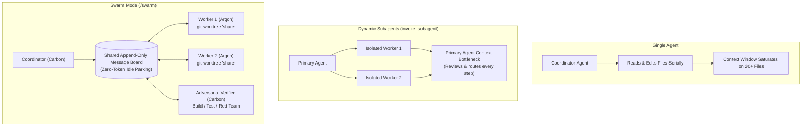
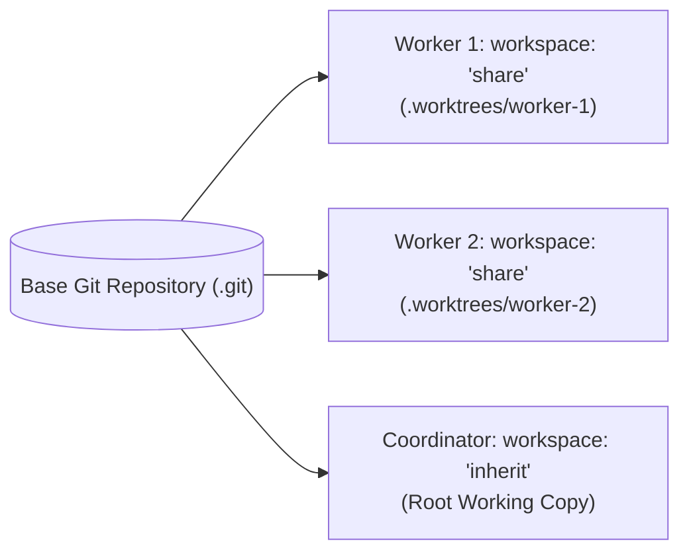

# Antigravity 2.0 Multi-Agent Swarm Orchestration Guide
**Native Multi-Agent Teams Powered by Gemini 4 Carbon & Gemini 4 Argon**  
*Source Reference: Google Antigravity Official Blog (Nov 10, 2026)*

---

## 1. Paradigm Overview: Single Agent vs. Subagents vs. Swarms

In Google Antigravity 2.0, multi-agent execution scales across three distinct patterns:



### When to Trigger `/swarm`:
- **File Span:** Tasks modifying or auditing more than 5 distinct files or across multiple subdirectories.
- **Heterogeneous Work:** Tasks requiring simultaneous backend, mobile, frontend, and verification work.
- **Deep Verification:** Critical release pipelines requiring a dedicated adversarial verifier to challenge assumptions and prevent hallucinations.
- **Heavy Migrations & Security Audits:** Long-horizon tasks that exceed single-turn context limits.

---

## 2. Right-Sized Model Architecture: Carbon vs. Argon

Antigravity 2.0 allows heterogeneous model pinning within the same swarm. Pair model reasoning capability with agent leverage:

| Model | Primary Characteristics | Ideal Swarm Roles | Token Cost & Quota Profile |
|:---|:---|:---|:---|
| **Gemini 4 Carbon** | #1 CursorBench 4.0 / WANDR. Deep reasoning, long-horizon planning, rigorous verification loops, self-correction. | **Coordinator**, **Lead Architect**, **Adversarial Verifier**, **Security / Penetration Auditor** | High quota usage; deploys extra tokens for deep reflection. Reserve for high-leverage roles. |
| **Gemini 4 Argon** | Workhorse model for high-throughput software engineering, fast execution, low latency. | **Parallel Implementers**, **File Editors**, **Routine Unit Test Authors**, **Documentation Builders** | Balanced quota; fast iteration and rapid code generation. |
| **Gemini Flash / Flash-Lite** | Ultra-fast, minimal latency. | **Broad Sweeps**, **Linter Fixers**, **Asset Formatters**, **Log Parsers** | Extremely low quota consumption. |

### Model Allocation Strategy:
```text
Coordinator (Gemini 4 Carbon)
 ├── Mobile Worker (Gemini 4 Argon) ──────── [workspace: "share"]
 ├── Backend Worker (Gemini 4 Argon) ─────── [workspace: "share"]
 ├── Web Admin Worker (Gemini 4 Argon) ───── [workspace: "share"]
 └── Adversarial Verifier (Gemini 4 Carbon) ─ [workspace: "inherit"]
```

---

## 3. Workspace Isolation: Eliminating Git Collisions

The #1 failure mode in parallel agent execution is **concurrent write collisions** on the same working tree. Antigravity 2.0 solves this via git worktree isolation:



### Workspace Modes:
1. `workspace: "share"` *(Recommended for Authors)*:
   - Allocates an independent Git worktree (`git worktree add`) sharing the repository's underlying `.git` database.
   - Multiple agents can edit, build, compile, and commit simultaneously on distinct branches without locking files or clobbering uncommitted edits.
2. `workspace: "branch"`:
   - Full isolated clone of the repository. Use for high-risk experiments, destructive rewrites, or major dependency version upgrades.
3. `workspace: "inherit"` *(Default)*:
   - Shares the coordinator's working copy directly. Best for read-only researchers, log auditors, and the final adversarial verifier after branches are merged.

---

## 4. Swarm Operational Lifecycle & Tool Protocol

### Step 1: Set Swarm Title
Name the swarm immediately upon decomposing the goal:
```json
swarm({"action": "title", "title": "Production Release Hardening & E2E Verification"})
```

### Step 2: Spawn Heterogeneous Workers
Pin specialized roles to appropriate models and workspaces:
```json
// High-leverage implementer in isolated worktree
swarm({
  "action": "add",
  "name": "mobile",
  "model": "gemini-4-argon",
  "workspace": "share",
  "brief": "You own lib/core/services/offline_sync_service.dart. Implement the mutex lock and atomic dequeue. Run flutter test when complete and report diff summary."
})

// Dedicated adversarial verifier pinned to Carbon
swarm({
  "action": "add",
  "name": "verifier",
  "model": "gemini-4-carbon",
  "workspace": "inherit",
  "brief": "You are the adversarial verifier. Your job is to challenge all diffs, run linter checks (flutter analyze), execute edge tests, and verify zero regressions. Do NOT write feature code."
})
```

### Step 3: Broadcast Assignments & Updates
Post publicly to the shared board. All swarm members read the board chronologically:
```json
post_message({"text": "@mobile Please implement the cascading quarantine logic for failed parent records. @verifier prepare adversarial edge test cases."})
```

### Step 4: Zero-Token Idle Parking (`swarm_wait`)
Coordinator and idle workers park at **zero token cost** while waiting for responses:
```json
swarm_wait({"mentions_only": true, "since": 52})
```
- While waiting, the model consumes 0 tokens.
- Reactive wakeup fires immediately when an @mention, `@all`, or new relevant message arrives.

### Step 5: Dynamic Model Hot-Swapping
When a worker completes deep architectural thinking and moves to mechanical file editing, or when managing quota limits:
```json
swarm({"action": "model", "name": "mobile", "model": "gemini-4-argon"})
```

### Step 6: Merging & Permanent Worker Teardown
Once a worker's task is completed and verified:
1. Merge the worker's branch or commit into the primary branch.
2. Permanently terminate the worker and prune its worktree:
```json
swarm({"action": "kill", "name": "mobile"})
```

---

## 5. UI Steering & Real-Time Monitoring

Antigravity 2.0 provides native visualization tools to monitor and steer the swarm:

### 1. The Swarm Side Pane (GUI)
- **Live Board Feed:** Displays chronological posts, mentions, and debate among agents in real-time.
- **Members Roster:** Lists every active agent, their pinned model (Carbon/Argon), state (`working`, `waiting`), and current task.
- **Trajectory Jumping:** Click on any worker in the Members roster to inspect their private chain-of-thought, tool calls, and output. You can intervene and message an individual worker directly.
- **Interactive Graph Timeline:** Scrub backward and forward across time to see how the code evolved from initial brief to verified diff.

### 2. Terminal CLI Board
For developers operating in the terminal:
- Press `Alt + S` or run `/swarm board` to open the full-screen terminal live board.

---

## 6. Anti-Patterns & Best Practices

| Anti-Pattern | Why It Fails | Recommended Best Practice |
|:---|:---|:---|
| **The Coding Coordinator** | Coordinator writes implementation code while workers wait, wasting parallel throughput. | Coordinator delegates all technical work. Coordinator reads, directs, decides, and reports to the human user. |
| **Monolithic Model Swarm** | Running 6 agents all on Gemini 4 Carbon exhausts user quota in minutes. | **Right-size the swarm:** Use Carbon for Coordinator and Verifier; use Argon or Flash for parallel editors. |
| **Shared Working Directory Collisions** | Two workers edit files in `workspace: "inherit"` simultaneously, triggering git merge conflicts and corrupted files. | Always specify `workspace: "share"` for workers that modify files or run builds concurrently. |
| **Vague Briefs** | "Fix the bugs in the backend." Worker hallucinates context and edits incorrect files. | Explicit briefs: State exact file paths, specific acceptance criteria, and command to verify completion. |
| **No Adversarial Verifier** | Workers declare their own code "complete" without independent validation, allowing edge regressions to slip into production. | Always spawn a dedicated `verifier` whose mandate is to break the code and run test suites. |
